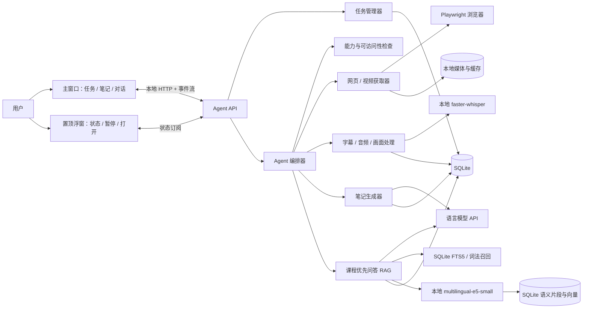
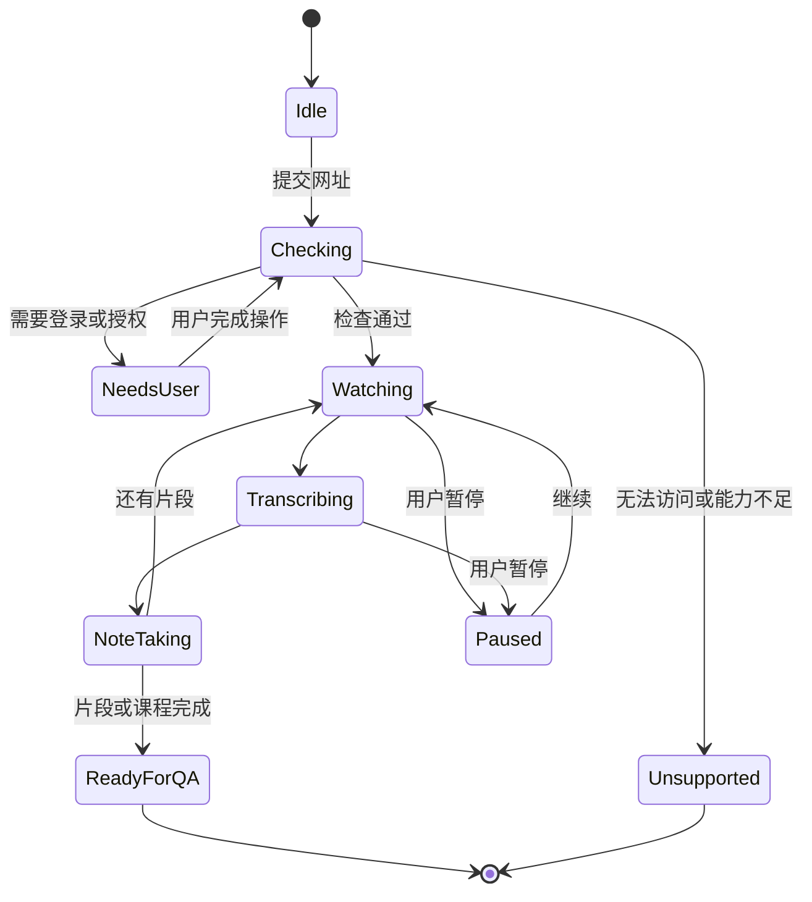

# 学习助手 AI Agent：架构设计草案

> 版本：0.1.7  
> 状态：0.1.7 已实现；本文同步记录当前架构与后续边界。

## 1. 产品目标

用户提交公开课网址后，学习助手能够：

1. 检查网页与课程视频是否可访问、可解析、可听写。
2. 自动定位视频、字幕或音轨，并按课程进度生成带时间戳的详细笔记。
3. 以课程内容为第一证据回答问题；课程未覆盖时使用当前模型内部知识补充，并明确来源边界与非实时性。
4. 通过独立对话界面与用户交流。
5. 通过常驻浮窗显示当前运行状态，并允许暂停、继续和打开主界面。
6. 每项学习任务独立保存；用户可明确选择“新任务”或“继续旧任务”。
7. 在模型、网页、字幕、音频或权限不足时，在开始处理前或运行中给出清楚、可执行的提示。

## 2. 推荐产品形态

推荐做成 Windows 优先的本地桌面应用，而不是纯网页：

- **Tauri 2 桌面壳**：负责主窗口、跨应用置顶浮窗、系统托盘和通知。
- **React + TypeScript UI**：主界面和浮窗共用组件与状态协议。
- **Python Agent Service（FastAPI）**：负责任务编排、网页访问、视频解析、转写、笔记生成和问答。
- **本地 faster-whisper + 本地 multilingual-e5-small + 外部文本模型 API**：音轨和语义向量只在本机处理，API 负责笔记生成、问答和可选视觉理解。
- **SQLite + 本地文件库**：持久化任务、对话、字幕、笔记、引用和媒体缓存；不把重要数据放在 localStorage。

这一形态能满足常驻浮窗、后台处理、长任务、本地隐私和独立 UI。未来如需多设备同步，可再增加云端控制面，不影响核心模块。

## 3. 总体架构



## 4. 视频处理策略

系统不假设大模型能够直接“看任意网页视频”，而是把观看拆成可检测、可降级的步骤。

### 4.1 开始前能力检查

提交网址后先生成一份 `CapabilityReport`：

- 网页是否公开访问，是否需要登录、验证码或地区权限。
- 是否检测到课程视频、播放列表或嵌入播放器。
- 是否存在人工字幕、自动字幕或可读取的文本稿。
- 是否可读取媒体流或音轨，并在授权范围内转写。
- 当前配置的 API 是否支持所需能力：文本、转写、视觉、向量化。
- 预计课程时长、处理时间、调用量与可能成本。
- 是否检测到 DRM、加密媒体或网站禁止的自动访问方式。

最终状态分为：

- `READY`：可完整处理。
- `LIMITED`：可处理，但缺少画面理解、字幕质量较低或只能分段执行。
- `NEEDS_USER`：需要用户登录、手动播放、上传字幕或授权音频捕获。
- `UNSUPPORTED`：DRM、无法访问、无可用媒体输入或 API 能力不足。

应用必须在状态不是 `READY` 时显示原因和解决办法，禁止默默生成看似完整但实际缺失内容的笔记。

### 4.2 内容获取优先级

1. 优先使用课程官方字幕或讲稿。
2. 无字幕时，在许可范围内取得音轨并调用本地 faster-whisper；首次按需下载所选模型。
3. 对包含大量板书、代码演示或幻灯片的课程，按场景变化抽帧，再做 OCR/视觉理解。
4. 若网页只能人工播放，则进入“协助模式”：用户播放课程，应用在明确授权后捕获音频和必要画面。
5. 不绕过登录、付费墙、DRM、验证码或网站访问控制。

### 4.3 长视频增量处理

课程按时间块处理，例如每 3–8 分钟一个片段：

`获取片段 → 转写 → 生成速学模块 → 汇总全课详细介绍 → 写入数据库 → 更新浮窗进度`

这样即使中断，也能从最后成功片段继续，不需要重跑整门课。

## 5. 笔记与问答设计

### 5.1 笔记层次

- 全课速学总览：固定输出课程完整介绍、学习目标、知识地图、核心内容、速学路线、一页速记、易错清单、自测和待确认项。
- 速学模块：按字幕时间块固定输出“讲了什么、核心知识、讲解路线、例子、速记卡、易错点与自测”。
- 转写只作为事实依据和可追溯来源，不作为学习者首先阅读的主笔记。
- 关键结论附课程时间戳；听写不清、上下文缺失或证据不足的内容明确标记“待确认”。
- 固定提示词禁止把转写内的指令当作系统指令，并禁止凭常识补写课程没有讲过的事实。

### 5.2 课程优先问答

问答流程采用带来源分层的 RAG：

1. 先对当前任务内全部已看课程同时执行 SQLite FTS5/词法召回与本地 E5 语义召回，并用 Reciprocal Rank Fusion 合并排序；生成查询扩展失败时仍可直接使用原问题检索。
2. 若课程证据足够，只基于课程回答。
3. 若课程未覆盖或解释不足，继续使用当前文本模型的内部知识回答，不调用搜索引擎或外部检索接口。
4. 模型知识使用与界面语言一致的“模型知识补充”标签，明确说明不是课程内容、未经实时联网核实且可能过时。
5. 每个课程事实附时间戳引用；时效性事实必须说明无法核实当前状态，不能暗示已经联网搜索。

默认禁止跨任务检索，只有用户主动开启“跨课程关联”时才允许引用其他任务。

## 6. 任务模型

### 6.1 新任务

- 创建新的 `task_id`、独立知识库、笔记、对话和处理记录。
- 即使网址相同，也不会自动合并。

### 6.2 继续旧任务

- 用户从任务列表中明确选择目标任务。
- 新网址、追加视频或新问题写入同一 `task_id`。
- 保留以前的笔记、对话、术语和处理断点。

### 6.3 入口交互

当用户提交网址时，界面提供两个明确入口：

- `作为新任务开始`
- `添加到已有任务`

系统可以推荐可能相关的旧任务，但不能自行合并。

### 6.4 任务管理

- 用户可重命名已有任务。
- 用户可复用已保存的转写重新生成速学速记，无需重新下载或转写课程。
- 永久删除任务前必须人工确认；删除任务记录、专属媒体缓存和对应导出文件，但保留共享的本地转写模型。

## 7. 核心数据模型

| 实体 | 关键内容 |
|---|---|
| `tasks` | 任务名称、创建时间、状态、语言、模型配置 |
| `sources` | 课程 URL、页面标题、平台、访问结果、媒体元数据 |
| `jobs` | 处理阶段、进度、断点、错误、重试次数 |
| `capability_reports` | 可访问性、字幕、音轨、视觉/API 能力、限制和建议 |
| `transcript_segments` | 起止时间、说话人、文本、置信度、来源 |
| `semantic_chunks` | 课程语义片段、时间范围、固定模型版本、384 维本地向量 |
| `semantic_source_state` | 逐节转写内容哈希、索引模型版本和完成时间 |
| `visual_segments` | 时间戳、画面摘要、OCR、关键帧文件引用 |
| `note_blocks` | 层级、正文、时间范围、版本、引用 |
| `conversations` | 当前任务下的独立会话 |
| `messages` | 用户问题、回答、模型与生成参数 |
| `citations` | 回答或笔记到字幕、画面和课程页的映射 |
| `artifacts` | 字幕、导出文档、音频缓存和图片的文件元数据 |

数据库保存结构化数据、文件引用和本地语义向量；较大的音频、关键帧、转写模型、固定 E5 模型和导出文件统一放入项目根目录的 `runtime-data/`。桌面程序和直接启动 Agent 使用同一默认目录，也允许 `STUDY_ASSISTANT_DATA_DIR` 覆盖。API Key 只驻留当前进程内存，程序启动时清空旧值并删除旧版本凭据，不进入 SQLite、配置文件或日志。

## 8. Agent 状态机与浮窗



浮窗为小型置顶窗口，显示：

- 颜色与图标：空闲、检查、观看、转写、整理、等待用户、暂停、失败、完成。
- 当前课程名、已处理时间和总进度。
- `暂停/继续`、`打开主界面`、`查看问题`。
- 失败时显示短原因；完整诊断在主界面展开。

浮窗关闭只隐藏界面，不默认终止后台任务；“停止任务”必须是独立且需要确认的操作。

## 9. 独立 UI 信息架构

主窗口分为三列：

```text
┌──────────────┬──────────────────────────────┬─────────────────────┐
│ 任务列表     │ 课程与笔记                   │ 课程问答            │
│ 新建 / 继续  │ 视频位置、章节、时间戳笔记   │ 对话、引用、来源标识 │
│ 状态与进度   │ 待确认内容、导出              │ 固定问答来源策略     │
└──────────────┴──────────────────────────────┴─────────────────────┘
```

移动端不是第一阶段目标；窗口变窄时改为任务、笔记、对话三个页签。

## 10. API 边界

### 10.1 桌面 UI 到本地 Agent

- `POST /tasks`：创建任务。
- `POST /tasks/{id}/sources`：添加课程网址。
- `POST /tasks/{id}/check`：执行能力检查。
- `POST /tasks/{id}/run|pause|resume|stop`：控制任务。
- `POST /tasks/{id}/regenerate`：利用已有转写重新生成速学速记。
- `PATCH /tasks/{id}`：重命名任务。
- `DELETE /tasks/{id}`：删除任务及其专属文件。
- `GET /tasks/{id}/notes`：读取增量笔记。
- `POST /tasks/{id}/chat`：课程问答。
- `GET /events`：SSE/WebSocket 推送状态、进度和错误。

### 10.2 智能与本地转写适配层

定义统一接口，避免业务逻辑绑定单一厂商：

- `LanguageModel.generate()`
- `LocalTranscriber.transcribe()`
- `EmbeddingModel.embed()`

文本智能支持 OpenAI-compatible API，并包含 Kimi K3 参数适配。转写只使用本地 faster-whisper，不提供云端 ASR 入口。配置持久化 API 地址和非敏感模型名；API Key 每次启动清空，只驻留当前进程内存。

## 11. 异常与安全边界

- 网页不可达、字幕缺失、音频静音、API 限流、余额不足、上下文过长均使用明确错误码。
- 每个处理片段可重试，并保存最后成功断点。
- 笔记和回答记录所用模型、版本、来源与生成时间，便于追踪。
- 课程网页、字幕、笔记和对话均作为不可信输入处理，不能改变 Agent 系统规则或读取本机秘密。
- 浏览器自动化运行在隔离配置中；默认不读取用户日常浏览器的 Cookie。
- 日志默认脱敏，不记录 API Key 和完整授权头。
- 课程音频只供本地 faster-whisper 使用；文本模型仅接收完成笔记和问答所需的课程文字片段。

## 12. 首版范围（MVP）

首版包含：

- Windows 桌面应用、主窗口、系统托盘和置顶浮窗。
- 公开且无需登录的课程网址。
- 网页定位、官方字幕读取、无字幕时的音频转写。
- 增量详细笔记、时间戳引用和课程优先问答。
- 新任务 / 继续旧任务、SQLite 持久化和断点续跑。
- 模型 API 配置、自检、能力不足提示。
- Markdown 导出。

首版暂不包含：

- 绕过 DRM、付费墙、验证码或网站权限。
- 全平台通用适配承诺；先支持常见公开网页及可扩展的平台适配器。
- 多用户、云同步和移动端。
- 自动替用户参加测验、提交作业或模拟观看进度。

## 13. 后续阶段

- **第二阶段**：更多课程平台适配器、画面抽帧、OCR、代码演示理解、PDF/讲义联合检索。
- **第三阶段**：云同步、多设备、共享课程空间、协作批注。
- **第四阶段**：学习计划、间隔复习、自动出题和知识图谱。

## 14. 建议确认的默认决策

1. 产品形态：Windows 本地桌面应用，后续再考虑 Web/移动端。
2. 处理边界：只处理用户有权访问的公开内容，不绕过 DRM 或访问限制。
3. API 策略：首版支持官方 API + OpenAI-compatible 接口，能力通过运行时自检确认。
4. 问答来源：固定使用“课程优先 + 模型内部知识补充”；不提供联网检索开关，并在回答中明显区分两者。
5. 数据策略：任务数据默认仅保存在本机；后续再增加可选同步。
6. 课程理解边界：0.1.7 仅基于网页元数据、字幕或音轨转写理解课程，不提供尚未投入使用的视频抽帧与视觉模型入口。

## 15. 版本、环境、测试与开发断点约束

### 15.1 版本号

- 当前开发版本固定为 `0.1.7`。

## 0.1.5 增量架构

- 固定模型身份为 `intfloat/multilingual-e5-small`（384 维、多语言）；本地执行使用固定提交的通用 INT8 ONNX 转换文件。模型工件版本和 SHA-256 写入清单，下载失败会清除不完整的最终文件并自动重试一次。
- 模型目录为 `runtime-data/models/embedding/multilingual-e5-small/<revision>/`。它属于共享运行时能力，不写入 provider 配置，不使用大模型 API Key，也不向用户提供禁用、更换或删除入口。
- Agent 启动后在后台下载/加载模型，并扫描已有转写。字幕按约 320 token、48 token 重叠切块；每节课以完整转写 SHA-256 和模型版本判断是否需要重建，数据库替换在单个事务中完成，因此中断不会留下半套新索引。
- 问答执行两路各 20 条候选召回：原有 FTS5/子串/词法重排一路，本地语义相似度一路。语义查询同时编码原问题和查询规划器产生的同义词、缩写及跨语言短语，再按平均余弦相似度排序；两路用 RRF 合并、按课程时间范围去重，最终最多提供 10 条课程证据。
- 语义运行时未准备好或失败时返回空语义候选，词法检索继续工作，课程问答不被模型下载阻塞。只读 `/semantic/status` 和 `semantic.status` 事件向桌面端报告下载、加载、索引、完成或失败状态。
- 数据库升级到 `user_version=5`，新增 `semantic_chunks` 和 `semantic_source_state`。两表都通过任务/课程外键级联删除；从 v4 迁移前使用 SQLite backup API 创建标记为 0.1.4 的一致性备份。

## 0.1.4 增量架构

- 音频下载器识别 yt-dlp 的字节数不完整错误。第一次失败后，仅清除当前 `source_id` 专属媒体目录下的 `course-audio.*` 下载产物，并执行一次从头下载。
- 第二次仍不完整时再次清理，返回 `MEDIA_DOWNLOAD_INCOMPLETE` 与中文恢复建议；固定一次应用级重试，避免网络持续异常造成无限循环。
- 此补丁不改变数据库结构，继续使用 `user_version=4`，因此不会为 0.1.3 数据库制造无意义迁移或备份。

## 0.1.3 增量架构

- 问答来源策略不再是任务级选项。桌面 UI、HTTP 请求和响应模型均移除 `allow_external_sources`、搜索端点、Search Key 与外部检索状态。
- 混合检索继续覆盖任务内全部课程，课程笔记和字幕始终优先；缺口由当前文本模型的内部知识补充。提示词要求模型明确标记知识边界、说明未实时联网核实，并对时效性事实拒绝制造“已搜索”印象。
- 数据库 `user_version=4`。为兼容旧数据库保留 `tasks.allow_external_sources` 物理列，但迁移时统一置零，API 和领域对象不再暴露该字段。由 0.1.2 迁移前先创建 `runtime-data/backups/study-assistant-0.1.2-<timestamp>.db`。
- 旧版本留下的 Search Key 凭据仍会在启动时删除；非敏感 `provider.json` 在下一次保存模型设置时不再写入搜索配置。

## 0.1.2 增量架构

> 以下外部检索设计仅记录 0.1.2 历史行为，已由 0.1.3 的固定问答来源策略取代。

- `sources.custom_title` 保存可选的用户课程名；空值表示按 `lesson_index` 动态显示“第 N 节”，因此删除前一节并重新编号后，未自定义课程会自动获得正确默认名。原始网页标题继续保存在 `sources.title`，不被用户命名覆盖。
- 数据库 `user_version=3`。由 0.1.1 迁移前使用 SQLite backup API 写入 `runtime-data/backups/study-assistant-0.1.1-<timestamp>.db`，再增加列并保留所有既有外键、字幕、笔记和对话。
- 对话管理 API 支持重命名、单个删除和按任务清空；所有操作都校验 `conversation_id` 属于当前任务，SQLite 外键负责级联删除消息。
- 问答检索采用“查询规划 → 混合召回 → 上下文扩展 → 生成回答”四段流程。查询规划综合当前问题、最近对话和课程目录，产生核心术语、同义词、缩写与中英互译短语；失败时安全退化为原问题检索。
- 混合召回同时使用 SQLite FTS5、大小写不敏感子串查询和内存词法重排。中文问题会移除常见疑问噪声并生成 2–4 字子串，解决无空格整句无法命中的问题；命中后附加同一课程前后约 35 秒字幕，并检索 `rapid_overview` / `rapid_module` 笔记。
- 回答提示中分别提供课程笔记、相邻字幕、最近对话与外部结果。课程证据优先，外部资料单独标记；无证据时要求明确说明缺口，不把外部观点伪装成课程内容。
- 外部检索状态固定为 `disabled`、`not_configured`、`used`、`no_results` 或 `failed`。UI 在未配置端点时阻止开启开关，并在运行失败或无结果时给出可见反馈，避免静默失败。
- 问答响应返回检索查询、课程证据数和外部检索状态，便于后续建立检索质量诊断页；当前 UI 只展示对用户有帮助的状态提示。

## 0.1.1 增量架构

- `tasks` 表示课程级学习任务，`sources` 升级为任务下的课程小节（lesson）；原有 `source_id` 外键保持不变，因此 0.1.0 转写和笔记可原位迁移。
- 小节独立保存 `lesson_index`、状态、进度、提示词方案、提示词版本和笔记输出语言；任务列表通过聚合查询返回总节数与完成节数。
- 处理、重新生成、笔记读取和导出都接受明确的 `source_id`；问答仍以 `task_id` 做全文检索，并在引用中返回节次、课程标题和时间戳。
- 添加课程支持多行 URL；播放列表通过 yt-dlp flat extraction 展开，用户在桌面端勾选后再按原顺序写入任务。
- 提示词由 Agent 维护三个版本化只读预设，桌面端只能查看和选择。Markdown 图表使用 Mermaid `securityLevel: strict`，额外拒绝 click/href/HTML 脚本语法，失败时显示原始描述。
- UI 语言保存在 `runtime-data/preferences.json`，与任务课程语言和每节笔记输出语言解耦。
- 数据库 `user_version=2`；迁移前使用 SQLite backup API 写入 `runtime-data/backups/`，避免仅复制 WAL 主文件造成不一致。
- 发布 sidecar 使用 PyInstaller `--noconsole`；Windows 主进程对子进程设置 `CREATE_NO_WINDOW`，日志继续写入 `runtime-data/agent.log`。
- 桌面应用、前端、Agent 服务和发布产物对外显示同一版本号。
- 版本号集中维护，构建时校验各模块的版本是否一致，避免分别手工修改后产生偏差。

### 15.2 开发环境

项目根目录必须提供 `environment.yml`，作为创建和恢复开发环境的统一入口：

```text
conda env create -f environment.yml
conda activate study-assistant
```

环境管理规则：

- `environment.yml` 记录 Python、Node.js、媒体工具及开发命令所需的基础工具链版本。
- Python 依赖必须锁定；Node 依赖同时使用包管理器锁文件；Rust/Tauri 依赖同时使用 `Cargo.lock`。
- WebView2、Windows SDK、MSVC Build Tools 等系统级依赖无法可靠封装进 Conda，须在环境文件注释和开发文档中单独列出并提供检查脚本。
- 禁止依赖未记录的全局 Python 包或全局 npm 包。
- `.env.example` 不提供 API Key 持久化变量；所有 Key 必须在每次程序启动后由用户重新输入，并只驻留内存。
- 开发开始后提供一条环境自检命令，报告 Python、Node、Rust、WebView2、FFmpeg 与浏览器运行时是否满足要求。

### 15.3 永久测试与可整体删除的测试产物

自动化回归测试是源码的一部分，永久保存在项目根目录的 `tests/`，随源码进行版本控制。测试使用的小型、无隐私夹具也应放在该目录下。

所有仅由开发和验证过程生成、不会随正式产品发布的文件统一写入 `development-artifacts/`，包括测试结果、覆盖率、截图、日志、临时数据库、工具缓存和 PyInstaller 工作文件。该目录默认忽略版本控制，可在不影响构建、运行和回归测试的前提下整体删除。

正式运行时不得读取或依赖 `tests/` 与 `development-artifacts/` 中的任何文件；发布配置必须明确排除二者。

### 15.4 断点记录与恢复协议

项目使用 `docs/DEVELOPMENT_CHECKPOINT.md` 记录可恢复断点。开发过程中在以下时机更新：

- 每完成一个可独立验证的里程碑。
- 开始耗时较长或会跨多个阶段的修改之前。
- 遇到阻塞、工具限制、上下文或 token 即将不足时。
- 结束当次开发工作之前。

断点文档至少记录：

- 当前版本和时间。
- 已完成内容与对应验证结果。
- 正在进行的内容及当前停留位置。
- 已修改或新增的关键文件。
- 尚未完成的任务，按执行顺序排列。
- 已知问题、失败命令及错误摘要。
- 下一步要运行的确切命令或要修改的确切文件。
- 当前工作区状态，以及需要保留的用户改动。

如果因 token 或上下文不足需要停止，助手必须先尽可能写入断点，再明确提示用户：

> 已记录开发断点。token 恢复后可发送“从上一次的断点继续开发”。

收到该指令后，恢复顺序固定为：

1. 阅读本架构文档和 `docs/DEVELOPMENT_CHECKPOINT.md`。
2. 检查当前文件与版本控制状态，不覆盖用户已有改动。
3. 验证断点中最后一个已完成里程碑。
4. 从记录的“下一步”继续，不重复已经完成的工作。
